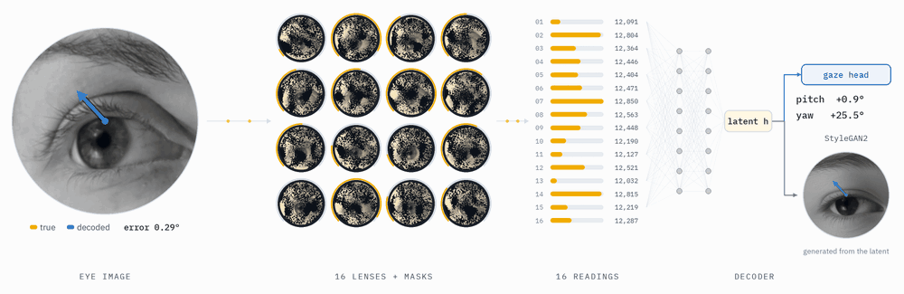
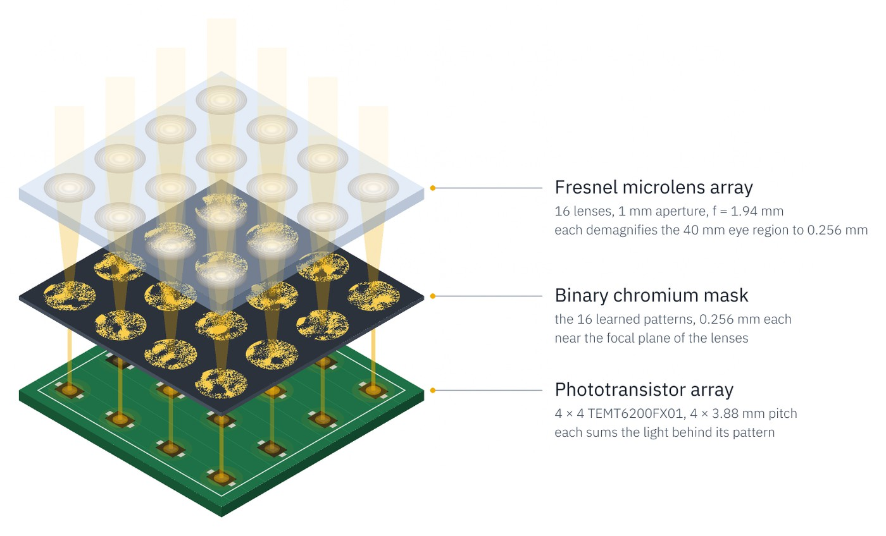
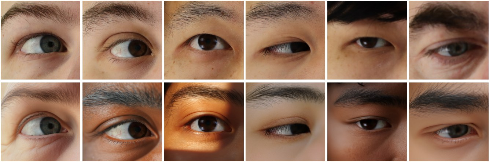

<h1 align="center">Low Latency Gaze Tracking<br>via Latent Optical Sensing</h1>

<p align="center">
  Yidan Zheng<sup>*</sup>, Matheus Souza<sup>*</sup>, Kaizhang Kang,
  Qiang Fu, Hadi Amata, Wolfgang Heidrich<br>
  KAUST · SIGGRAPH Asia 2026<br>
  <sub><sup>*</sup> Equal contribution</sub>
</p>

<p align="center">
  <a href="https://vccimaging.org/Publications/Yidan2026Gaze/">Project page</a> &nbsp;·&nbsp;
  <a href="https://arxiv.org/abs/2605.17990">Paper</a> &nbsp;·&nbsp;
  <a href="https://drive.google.com/drive/folders/1nZYi9PGOghLQ0b_YegX2uc5saHjukf-1?usp=sharing">Pretrained models</a> &nbsp;·&nbsp;
  <a href="docs/reproduction.md">Documentation</a>
</p>

LatentGaze combines learned optical masks with a compact neural decoder to estimate gaze
from **16 intensity measurements**. The physical prototype achieves **3.4 ms light-to-gaze
latency** and **5.96° mean gaze error across 12 subjects**, using 12 calibration points
per subject.

<p align="center">
  
</p>

**Figure 1. Gaze prediction from optical measurements.** Each masked channel produces
one reading. The decoder maps the 16 readings to a 256-dimensional latent `h`, which
feeds the gaze head. A reconstruction branch uses the same latent to
generate the eye image shown on the right.

The decoder contains **244,324 parameters, including its gaze and eye-validity heads**.
For reconstruction, `h` is repeated across StyleGAN2's style layers and added to the
generator's mean latent before synthesis. See the [decoder example](docs/reproduction.md#load-the-decoder)
to load the weights and predict gaze.

## Optical hardware

<p align="center">
  
</p>

**Figure 2. The optical encoder.** A microlens array forms 16 views of the eye, each
modulated by a learned binary chromium mask. The 4 × 4 phototransistor array integrates
the transmitted light into one scalar reading per channel. The three layers are shown
from top to bottom.

Hardware design files are in [`hardware/`](hardware/):

- [Microlens array](hardware/micro_lens)
- [Chromium mask layout](hardware/mask.gds)
- [PCB and readout electronics](hardware/circuit)

## Identity augmentation

<p align="center">
  
</p>

**Figure 3. Augmenting appearance while preserving the gaze label.** Original ETH-XGaze
eye crops are shown in the top row and their augmented counterparts below. A SAM 3 mask
protects the eye region while FLUX inpaints the surrounding appearance. Each augmented
sample keeps the original gaze label.

The [augmentation script](scripts/augment_example.py) runs the process on one crop using
the [augmentation environment](docs/reproduction.md#augmentation-environment).
ETH-XGaze images must be obtained from the [dataset provider](https://ait.ethz.ch/xgaze).

## Getting started

### 1. Install the environment

```bash
conda create -n latentgaze python=3.9 -y
conda activate latentgaze
pip install torch==1.12.1+cu113 torchvision==0.13.1+cu113 \
    --extra-index-url https://download.pytorch.org/whl/cu113
pip install -r requirements.txt -c constraints.txt
```

StyleGAN2's CUDA kernels compile on first use and require `nvcc`; reference operations
are used when it is unavailable. Run the CPU checks with `python -m pytest tests`.

### 2. Download the models

Download the [pretrained weights](https://drive.google.com/drive/folders/1nZYi9PGOghLQ0b_YegX2uc5saHjukf-1?usp=sharing)
into `weights/`. The [weights guide](docs/reproduction.md#pretrained-weights) lists the
checkpoint filenames and models.

### 3. Evaluate the prototype recordings

Run 12-point calibration on the three included subjects (001, 003 and 012):

```bash
python scripts/calibrate.py --config configs/calibration.yaml 'budgets=[12]'
```

Results are saved to `runs/calibration/`.
ETH-XGaze evaluation also requires the [test LMDB](docs/reproduction.md#data-preparation).

For the full workflows, see [evaluation](docs/reproduction.md#evaluation),
[data preparation](docs/reproduction.md#data-preparation) and
[training](docs/reproduction.md#training).

## Citation

```bibtex
@misc{zheng2026lowlatencygazetracking,
  title         = {Low Latency Gaze Tracking via
                   Latent Optical Sensing},
  author        = {Yidan Zheng and Matheus Souza and
                   Kaizhang Kang and Qiang Fu and
                   Hadi Amata and Wolfgang Heidrich},
  year          = {2026},
  eprint        = {2605.17990},
  archivePrefix = {arXiv},
  primaryClass  = {cs.CV},
  url           = {https://arxiv.org/abs/2605.17990},
}
```

## License

The software, pretrained weights and included prototype recordings are covered by
[LICENSE-SOFTWARE](LICENSE-SOFTWARE). The existing hardware materials retain the
repository's [MIT license](LICENSE). Third-party components retain their own licenses,
as recorded in their source-file headers.

## Acknowledgements

This work builds on [StyleGAN2-ADA](https://github.com/NVlabs/stylegan2-ada-pytorch),
[pixel2style2pixel](https://github.com/eladrich/pixel2style2pixel),
[lpips-pytorch](https://github.com/S-aiueo32/lpips-pytorch),
[ETH-XGaze](https://ait.ethz.ch/xgaze), FLUX.1, SAM 3, CLIP and DINOv2.
